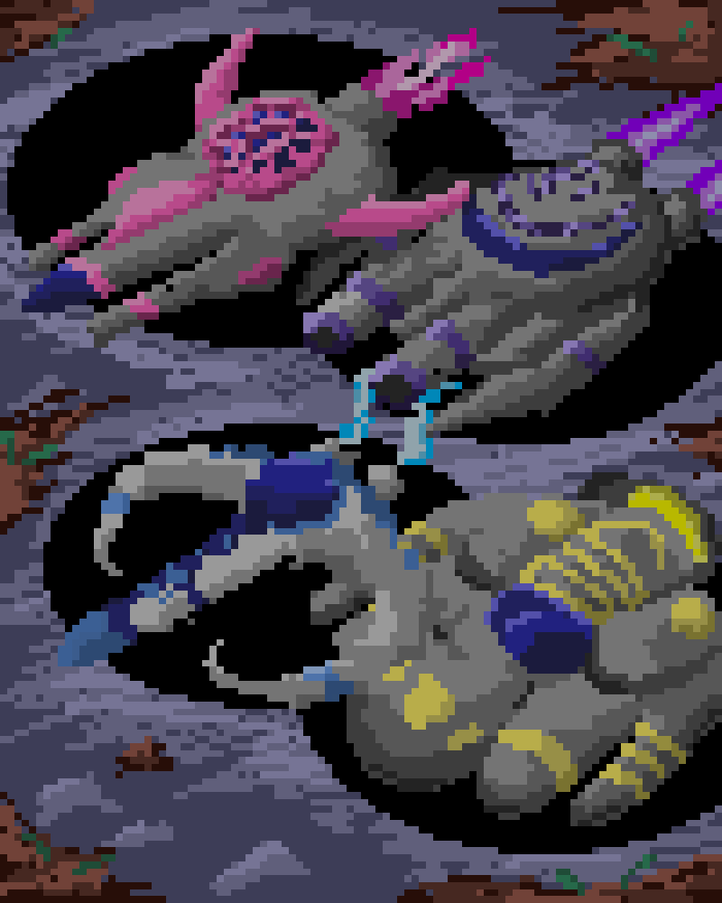

# Coded Conquest: Infinite Skies

A vertical-scrolling space shooter for Windows, built in C# with Windows Forms. Pick one of four ships, dodge and shoot down waves of viruses and corrupted enemies, and post your ship's score to the leaderboard.


<p>
  
  
</p>

| | |
|---|---|
| **Type** | 2D arcade shooter, school project |
| **Stack** | C#, .NET Framework 4.7.2, Windows Forms, GDI+ drawing, Windows Media Player COM control for music |
| **Highlights** | Timer-driven game loop, double-buffered rendering, looping parallax background, per-ship stats, file-based leaderboard |

## Gameplay

- **Four ships with different stats**

  | Ship | Speed | Lasers per shot | Hearts |
  |---|---|---|---|
  | Chronos | 10 | 1 | 3 |
  | Innovator | 7 | 2 | 3 |
  | Cybernetic | 5 | 2 | 3 |
  | Sentinel | 4 | 2 | 6 |

- Enemies spawn at random positions, move to new target points, and shoot back
- Each enemy takes several hits; every kill is worth 10 points
- Lose a heart when hit by an enemy or its laser; the ship flashes on hit
- Pause menu (Esc) with resume, restart and exit
- Game over screen, then a leaderboard that ranks the most recent score for each ship

**Controls:** arrow keys to move, Esc to pause. The ship fires automatically.

## How it is built

- **Game loop.** Separate `System.Windows.Forms.Timer`s drive movement, auto-fire, enemy lasers, enemy spawns and the clock (`Form1.cs`).
- **Rendering.** Sprites are embedded resources loaded at runtime. The form is double buffered, and three background images scroll in a loop for a parallax effect (`OnPaint`, `UpdateBackgrounds`).
- **Collision.** Rectangle intersection between the player, enemies and both laser lists (`CheckCollisions`).
- **Data.** Ship stats are a `Dictionary<string, ShipAttributes>`. Each ship's latest score is saved to `CodedScores.txt` as a `ship,score` line, and the leaderboard sorts them.

## Project structure

```
Coded-Conquest/
├── CodedConquest.sln
└── CodedConquest/
    ├── Program.cs              entry point (opens the main menu)
    ├── MainMenuForm.cs         title screen
    ├── PickShip.cs             ship selection
    ├── Form1.cs                the game: loop, spawning, collisions, pause menu, scoring
    ├── gameOverMenu.cs         game over screen
    ├── Leaderboard.cs          scores ranked by ship
    ├── CodedScores.txt         saved scores
    ├── Resources/              sprites and backgrounds (embedded)
    └── Sounds/                 sound effects (copied next to the .exe on build)
```

## Running it

Requires Windows and Visual Studio 2022 with the **.NET desktop development** workload.

1. Open `CodedConquest.sln`.
2. Press **F5**.

The background music file (`In_Game_Music.wav`) is not included in the repo, so the game runs without music. Sound effects work.
